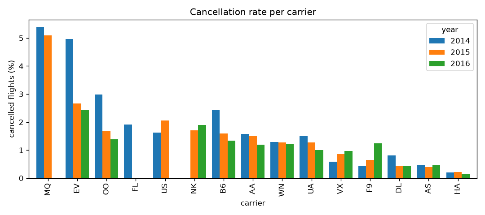

# flight-delays-graph-analysis

**What:** 17.3 million US domestic flights (2014-2016) as a Neo4j graph, with Cypher queries for delays, cancellations, hubs and trip search.  
**Result:** Cancellations fell from 2.18% to 1.17% in three years; all 24 totals from the graph match the raw data exactly.  
**Stack:** Neo4j 5, Cypher, Python, pandas

All US domestic flights from 2014 to 2016 in a Neo4j graph, with Cypher queries for the
questions I was curious about: did the network grow, which carriers and airports cancel or
delay the most, when does weather cancel flights, and how many times do you have to change
planes to get from a small airport to another one.

## Data and graph

The flights are the public on-time files from the US Bureau of Transportation Statistics
(one row per flight), airport names come from OpenFlights.

```
(:Airport)-[:ROUTE {carrier, year, month, flights, cancelled, delays, ...}]->(:Airport)
(:Airport)-[:CONNECTS {year, flights, avg_time, avg_arr_delay}]->(:Airport)
(:Plane)-[:FLEW_FOR {year}]->(:Carrier)
```

17 million single flights is too much for my laptop, so flights are grouped by month,
carrier and route. Each `ROUTE` keeps sums and counts instead of averages, so every average
in the queries is still exact. `CONNECTS` is a simpler layer per airport pair and year, used
for the trip search.

## Results

The network did not grow in these three years: about 5.8 million flights in 2014 and 2015,
and 5.6 million in 2016. But there were more planes each year (4,748, 4,896, then 5,035), and
the share of cancelled flights almost halved, from 2.18% to 1.54% to 1.17%.



- Envoy Air cancelled the most (5.4% in 2014), Hawaiian the least (about 0.2% every year).
- Chicago had the most cancelled departures in all three years.
- Half of all weather cancellations (49%) happen in January and February.
- Atlanta is the busiest airport and the biggest hub (165 direct destinations in 2016).

Trip search in 2016 is the part where a graph really helps. From Bangor (Maine) to Kona
(Hawaii) you need at least two changes, and the quickest option is BGR → DTW → SFO → KOA with
756 minutes in the air. Aspen to Burlington needs one change (ASE → ORD → BTV, 284 minutes),
and Boston to San Francisco has direct flights (388 minutes).

These times are the sum of the average flight times of the legs, so the time on the ground
between flights is not included.

## Checking the results

The graph only stores sums, so a mistake in the grouping or a query would give wrong numbers
without any error. `src/check_results.py` reads the raw files again with pandas and compares
24 totals (flights, cancellations, planes and miles per year, weather cancellations per
month) with the query results. All of them match.

## Limitations

- Grouped by month, so no questions about single flights or single days.
- The trip search ignores schedules, a two-leg route might not work in time.
- Some carriers merged in this period, so the carrier comparison is partly the same company.

## Run

Needs Python 3.10+ and Neo4j 5 running locally (password in `.env`, see `.env.example`).

```bash
pip install -r requirements.txt
./reproduce.sh      # download data, build the graph, run the queries, check the results
```

## More

[`docs/details.md`](docs/details.md) has the full data description, the complete graph model,
all results and figures, the step-by-step run, and ideas for what to try next. The queries
are in [`queries/`](queries/), one per file.
