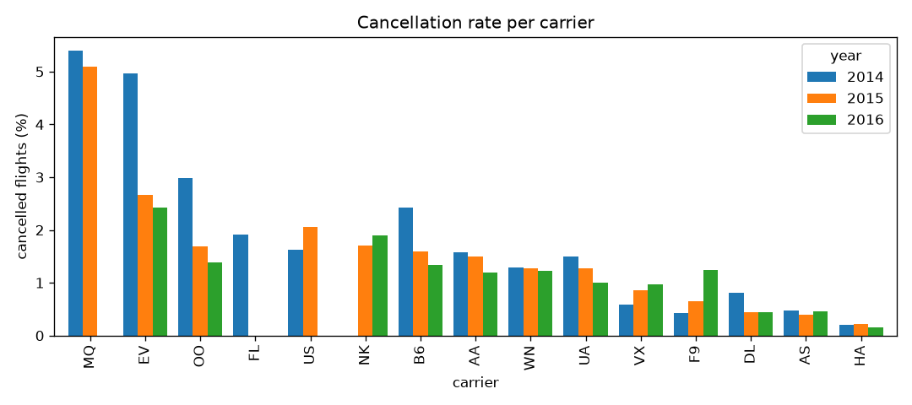
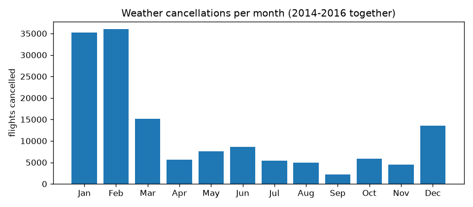
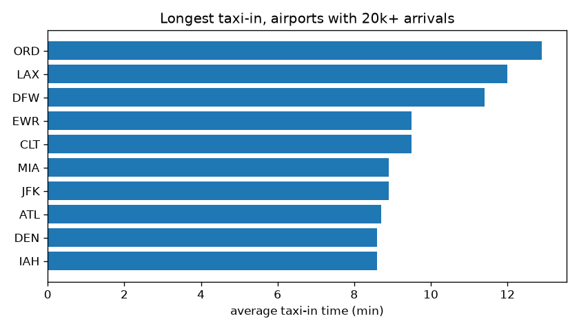

# Details

The longer version of the README: where the data comes from, the full graph model, all
results with figures, and every way to run it. The short version is in the
[README](../README.md).

## Data

- **Flights**: the monthly "Reporting Carrier On-Time Performance" files from the US Bureau
  of Transportation Statistics (transtats.bts.gov), January 2014 to December 2016. One row
  per flight, with carrier, tail number, origin, destination, delays, taxi times,
  cancellation and cancellation reason. 36 zip files, about 850 MB.
- **Airport names**: `airports.dat` from [OpenFlights](https://openflights.org/data.html).
- **Carrier names**: written by hand in `src/prepare_data.py` (15 carriers), because the BTS
  lookup table was not available when I downloaded the data.

The data is not in this repo. `download_data.sh` gets it.

## Graph model

```
(:Airport {code, name, city, state})
(:Carrier {code, name})
(:Plane {tail})

(:Airport)-[:ROUTE {carrier, year, month, flights, cancelled, weather_cancelled, ...}]->(:Airport)
(:Airport)-[:CONNECTS {year, flights, carriers, avg_time, avg_arr_delay}]->(:Airport)
(:Plane)-[:FLEW_FOR {year, flights}]->(:Carrier)
```

17 million single flights as relationships is too much for my laptop (8 GB RAM), so
`prepare_data.py` groups the flights by year, month, carrier, origin and destination. Each
group becomes one `ROUTE` relationship. It keeps counts and sums, not averages, so that every
average in the queries is still exact (sum of delays / number of flights with a delay value).

`CONNECTS` is a second, simpler layer for the travel questions: one relationship per airport
pair and year, over all carriers and months.

Size after loading: 334 airports, 15 carriers, 5,744 planes, 226,161 `ROUTE`, 13,924
`CONNECTS` and 15,049 `FLEW_FOR` relationships.

## Results

All numbers come from the queries in `queries/`, the full outputs are in `results/`.

### The network

| year | scheduled flights | cancelled | cancelled (%) | planes | miles flown |
|---|---|---|---|---|---|
| 2014 | 5,819,811 | 126,984 | 2.18 | 4,748 | 4.57 billion |
| 2015 | 5,819,079 | 89,884 | 1.54 | 4,896 | 4.73 billion |
| 2016 | 5,617,658 | 65,861 | 1.17 | 5,035 | 4.73 billion |

The number of flights did not grow, it went slightly down in 2016. But there were more planes
and more miles each year, and the share of cancelled flights almost halved.

Busiest airport by departures is Atlanta (1.12 million over the three years), then Chicago
O'Hare (819k) and Dallas/Fort Worth (719k). Atlanta also has the most direct destinations in
2016 (165), then O'Hare (150) and Denver (134).

15 carriers flew in this period, but not all of them for the whole time. AirTran only appears
in 2014, US Airways and Envoy stop after 2015, and Spirit only starts reporting in 2015.

### Cancellations and delays



- **Worst carrier for cancellations**: Envoy Air, 5.4% of its flights cancelled in 2014 and
  5.1% in 2015. In 2016 (when Envoy is no longer in the data) it was ExpressJet with 2.4%.
- **Best**: Hawaiian Airlines every year, between 0.15% and 0.22%.
- **City with the most cancelled departures**: Chicago in all three years (15,975 in 2014,
  10,564 in 2015, 5,522 in 2016). New York, Dallas/Fort Worth and Denver follow.
- **Average arrival delay**: Spirit (11.7 min) and Frontier (11.0 min) are the latest on
  average. Alaska Airlines arrives 1.2 minutes early on average and Delta is almost on time
  (0.6 min).



Weather cancellations are a winter problem. January and February together have 71,172 of the
144,555 weather cancellations (49%). September has the fewest (2,169).



Longest average taxi-in (from landing to the gate), for airports with at least 20,000
arrivals: Chicago O'Hare 12.9 min, Los Angeles 12.0 min, Dallas/Fort Worth 11.4 min.

### Getting from A to B (2016)

This is the part where a graph database really makes sense. In SQL this would be a
recursive query, in Cypher it is one line with `allShortestPaths`.

| trip | fewest changes | number of routes with that many changes | quickest route | flight time | expected delay at arrival |
|---|---|---|---|---|---|
| Bangor, ME → Kona, HI | 2 | 20 | BGR → DTW → SFO → KOA | 756 min | 0.0 min |
| Aspen, CO → Burlington, VT | 1 | 2 | ASE → ORD → BTV | 284 min | 6.3 min |
| Boston → San Francisco | 0 (direct) | 1 | BOS → SFO | 388 min | 1.7 min |

"Flight time" is the sum of the average flight times of the legs. The time on the ground
between two flights is not in the data, so a real trip takes longer. "Expected delay" is the
average arrival delay of the last leg, because that is the delay you have when you arrive.
Only legs with at least 52 flights in 2016 (about one a week) are used for the quickest route.

## What I would try next

- Keep single flights for one month, and follow one plane through its day to see how a delay
  in the morning spreads to the later flights.
- Use the scheduled departure and arrival times so that the trip search only returns
  connections you can actually make.
- Look at the delay causes (carrier, weather, air traffic, late aircraft), they are in the
  raw files but I did not use them yet.

## Run

You need Python 3.10+ and Neo4j 5 (I used Neo4j Community 5.26 with Java 17).

```bash
python -m venv .venv
source .venv/bin/activate
pip install -r requirements.txt

cp .env.example .env        # put your Neo4j password in .env
./reproduce.sh              # download, prepare, load, run queries, check
```

Or step by step:

```bash
./download_data.sh
python src/prepare_data.py   # about 2 minutes
python src/load_graph.py     # about 30 seconds
python src/run_queries.py
python src/check_results.py
```

The queries can also be pasted into the Neo4j Browser (http://localhost:7474). Queries 12 and
13 need the parameters `$origin`, `$dest`, `$year` and `$max_legs`, for example
`:param origin => "BGR"`.

## Files

```
download_data.sh      get the BTS files and the airport list
src/prepare_data.py   raw flights -> grouped CSV files
src/load_graph.py     CSV files -> Neo4j
src/run_queries.py    run queries/*.cypher, save results/ and figures/
src/check_results.py  compare the results with the raw data
queries/              one Cypher query per file
results/              query outputs as CSV
figures/              plots
```
